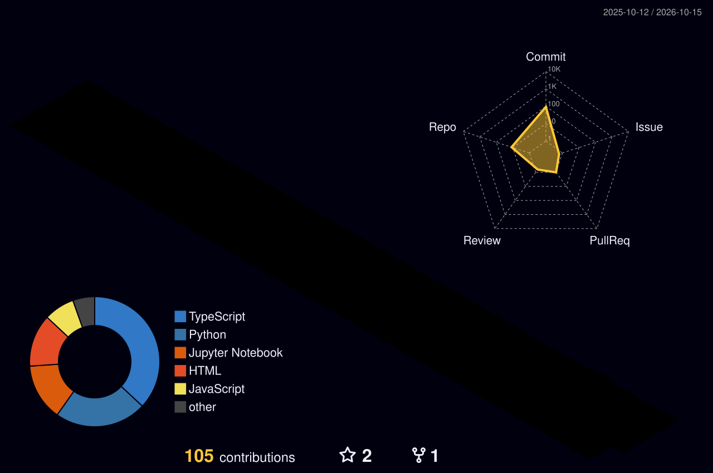

<!-- ======================== HEADER BANNER ======================== -->

<!-- ======================== TYPING SUBTITLE ======================== -->

 

<!-- ======================== QUICK LINKS & STATUS ======================== -->

  

---

### 🚀 Selected Projects

<table>
  <tr>
    <td width="50%" valign="top">
      <h4>01. 🛡️ <a href="https://github.com/artignite3/agentforge">AgentForge: Durable AI Agent Runtime</a></h4>
      

        
        
      

      
<b>Tech:</b> <code>Python</code>, <code>FastAPI</code>, <code>PostgreSQL</code>, <code>Docker</code>, <code>Azure</code>

      <ul>
        <li>Fault-tolerant asynchronous agent runtime with PostgreSQL distributed job leases, fencing tokens, durable checkpoints, and bounded retries.</li>
        <li>Secure code execution in non-root Docker sandboxes with strict isolation; deployed on Azure with 53 CI tests and live Gemini self-repair in 8.29s.</li>
      </ul>
    </td>
    <td width="50%" valign="top">
      <h4>02. 🌊 FluidTactics: Topological Flow Fields for Sports AI</h4>
      

        
        
      

      
<b>Tech:</b> <code>PyTorch</code>, <code>Neural ODEs</code>, <code>DEC Simplicial Complex</code>, <code>NumPy</code>

      <ul>
        <li>Physics-informed continuous spatio-temporal framework coupling Neural ODEs with Discrete Exterior Calculus to predict collective defensive collapse.</li>
        <li>Achieved 0.884 AUC-ROC and 0.708 F1 on SoccerNetGS, with custom CUDA Hodge projector caching yielding a 3× inference speedup.</li>
      </ul>
    </td>
  </tr>
  <tr>
    <td width="50%" valign="top">
      <h4>03. 🏏 <a href="https://github.com/artignite3/DREAM-Team_Predictor">NEW_X1: Cricket Intelligence & Optimal XI</a></h4>
      

        
        
      

      
<b>Tech:</b> <code>Python</code>, <code>Scikit-learn</code>, <code>PuLP MILP</code>, <code>FastAPI</code>, <code>Next.js</code>

      <ul>
        <li>Leak-free multi-format prediction engine over 3,000+ matches and 140+ rolling features combining gradient boosting and stacked ensemble modeling.</li>
        <li>Risk-adjusted PuLP MILP solver using empirical player covariance for optimal XI selection, paired with SHAP and local LLM reports.</li>
      </ul>
    </td>
    <td width="50%" valign="top">
      <h4>04. 🔍 <a href="https://github.com/artignite3/TEAM_MM">Redrob Candidate Discovery Engine (TEAM_MM)</a></h4>
      

        
        
      

      
<b>Tech:</b> <code>Python</code>, <code>BM25</code>, <code>FAISS</code>, <code>Cross-Encoder</code>, <code>LLMs</code>

      <ul>
        <li>Led a team of 4 to build a 7-stage Information Retrieval pipeline processing 100,000+ candidate profiles in &lt;5 minutes on CPU.</li>
        <li>Combined BM25 lexical search with FAISS dense semantic embeddings, Cross-Encoder re-ranking, and natural-language matching explanations.</li>
      </ul>
    </td>
  </tr>
  <tr>
    <td colspan="2" valign="top">
      <h4>05. 🏛️ Faculty Recruitment Portal (IIT Ropar Collaboration)</h4>
      

        
      

      
<b>Tech:</b> <code>Node.js</code>, <code>Express.js</code>, <code>MySQL</code>, <code>JavaScript</code>, <code>HTML/CSS</code>

      <ul>
        <li>End-to-end recruitment management platform featuring dedicated applicant and admin workflows, publication tracking, and automated academic profile generation.</li>
      </ul>
    </td>
  </tr>
</table>

---

### 🛠️ Technical Skills

- **ML & Deep Learning:** `PyTorch` • `Scikit-learn` • `NumPy` • `LLMs (Ollama)`
- **Programming Languages:** `Python` • `C / C++` • `SQL` • `JavaScript` • `HTML / CSS`
- **Web & Backend:** `FastAPI` • `Next.js` • `React.js` • `Node.js` • `Tailwind CSS` • `Streamlit` • `React Native (Basic)`
- **Databases & Cloud:** `PostgreSQL` • `MongoDB` • `MySQL` • `Docker` • `AWS` • `Vercel` • `GitHub Actions` • `Linux`
- **Design & Tools:** `Figma` • `Adobe After Effects` • `Git`

 

  
  
  
  
  
  
  
  
  
  
  
  
  

---

### 📊 GitHub Telemetry & Activity

<!-- 3D Isometric Year-Wise Contributions -->

  

<!-- Timeline & Core Telemetry -->

 

<!-- Languages by Repo & Commit Share -->

 

<!-- Commit Velocity & Productive Hours -->

---

### 🤝 Let's Connect

